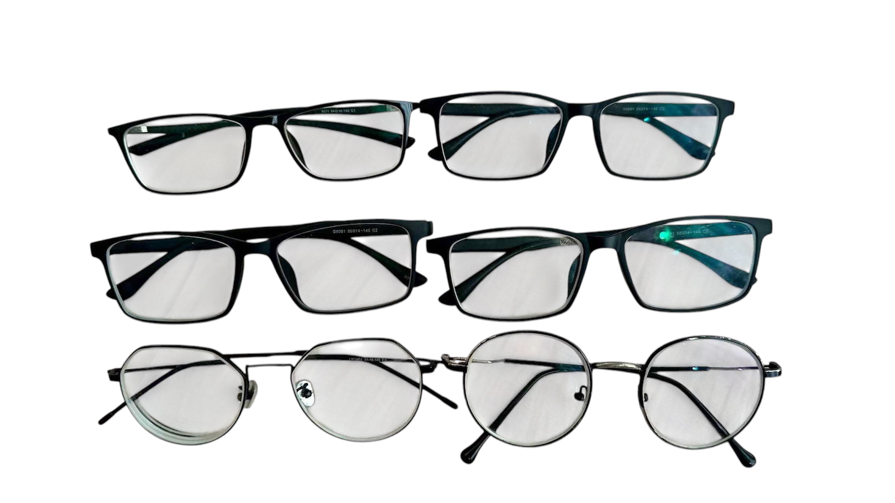

开发者的生活不仅仅是提交代码和模型训练运行。这篇文章记录了我旅程中非技术层面的部分——那些在终端之外塑造我的经历、失败和里程碑。

---

## 🏠 梅州的童年

我1995年出生于广东梅州——一个以客家文化闻名的小城市。我的小学邀请了一位摄影师来拍摄班级照片。现在再看这些照片，我看到了一个孩子，他不知道三十年后他会用GPU训练神经网络。

{: .centered }
{: .responsive }
*小学照片，梅州*{: .caption }

梅州不是一个科技中心。没有黑客马拉松，没有创业聚会，没有开发者社区。只有群山、客家美食和一个对一切都好奇的孩子。这种好奇心最终驱使我自学编程、从大学辍学、并追求软件职业生涯——但它始于此，在一个最大的技术事件就是安装宽带互联网的小城市。

---

## 🏆 NOIP——我的第一次编程竞赛

高中时，我参加了全国青少年信息学奥林匹克竞赛（NOIP）——中国的高中生竞赛。我们从广州到中山参加省级比赛。

考试是在Windows XP上进行的（在花了很多天学习Linux之后，这让我松了一口气）。我坐在来自汕头的陈一祥旁边，他轻松地编码，而我却在第一个问题上挣扎——试图分配一个100,000×100,000的数组，却被C++告知这是不可能的。

我没有赢得任何奖牌。但这次经历教会了我一些重要的东西：我喜欢用代码解决问题，即使我不擅长。而且我周围都是比我优秀得多的人，这既令人谦卑又激励人心。

{: .centered }
{: .responsive }
*2011年中山市NOIP比赛*{: .caption }

---

## 🚀 20岁辍学——LeanCloud岁月

高中毕业后，我进入了北京林业大学。但大学感觉很慢。我在构建Android应用、赢得黑客马拉松、并获得实习机会。19岁时，我在LeanCloud实习——一家由耶鲁博士共同创立的云平台初创公司，他曾在谷歌工作过。

我在LeanCloud的6个月里学到的比在大学的2年里还多。团队包括前谷歌、前阿里巴巴、前豌豆的工程师。技术负责人Dennis的开源项目被京东和腾讯使用。我的CEO离开了美国的舒适生活在北京建立了一个开发者平台。

我辍学了。我的父母并不高兴。但我知道我走上的是一条大学无法提供的道路——向那些构建过真正大规模产品的人学习。

{: .centered }
{: .responsive }
*北京林业大学——官方退学决定，2015年10月*{: .caption }

{: .centered }
{: .responsive }
*文件详情——"申请退学以从事创业活动"*{: .caption }

---

## 💼 21岁CEO——创业梦想

21岁时，我辞去了每月25000元的薪水，创办了自己的公司。受保罗·格雷厄姆的文章和Y Combinator理念的启发，我飞往硅谷，参观了谷歌校园，走访了YC的办公室，并遇到了来自麻省理工学院、斯坦福和清华的年轻创始人。

{: .centered }
{: .responsive }
*2016年硅谷Y Combinator访问*{: .caption }

我与叶孤城（Ye Gucheng）——一位受欢迎的iOS社区人物——合作建立了Reviewcode.cn——一个代码审查平台。我们在几周内获得了8000的日访问量。但产品需求不够强烈。我们转向了线下培训和研讨会，然后转向了软件外包。

硅谷之行改变了我的观点。我遇到了那些离开谷歌去创办初创公司的人，他们住在共享房屋里，每天编码16个小时。我遇到了马龙技术的CTO——一位拥有顶级会议论文的微软资深人士——在苏州街人行道上凌晨2点告诉我："年轻人，要有耐心。建立你的核心技能。要做出世界级的工作，你不仅需要好奇心，还需要改变世界的雄心。"

---

## 📈 从亏损45万人民币到200万人民币收入

创业之路并不顺利。在收到来自李笑来的50万人民币投资后，我犯了典型初创创始人新手错误：雇人太快，管理太松散，花费太随意。我觉得自己是CEO，停止了亲自做困难的工作。几个月内，我烧掉了45万人民币。

失败是痛苦的，但教育意义重大。我学到了：

- **创始人必须在早期亲自做核心工作**
- **在没有明确商业模式之前不要雇人**
- **轻松得来的钱会腐蚀**——当金钱来得太容易时，你会失去纪律

我重建了。转向软件外包，亲自处理每个客户电话、每个项目审查、每行关键代码。到2018年，公司已经拥有：

- 200万人民币以上的收入（2018年上半年）
- 50万人民币以上的利润
- 为小猿搜题和中科视拓等客户完成了40多个项目
- 15名全职和兼职工程师团队

关键见解：**外包并不光鲜，但它教会你生意实际上是如何运作的**——寻找客户、管理期望、兑现承诺、建立信任。

---

## 👥 AI & 趣直播——工程师社区

趣直播不仅仅是一个直播平台——它变成了一个社区。大约在2016-2017年间，随着我们举办关于编程、设计和技术的话题演讲，用户在微信群中聚集。最初只是即将到来的演讲的通知渠道，演变得更加庞大：一个跨越27个微信群、约3000名工程师的网络。

这个构成讲述了中国科技界当时的故事：大约四分之三是iOS工程师，其余是Android开发者、机器学习从业者、初创公司创始人和互联网专业人士。这些人当时正在实时构建移动互联网——那些数百万中国用户日常依赖的应用、平台和服务。

我们举办了大约80次演讲，拥有30000名用户和数百万次页面浏览量。每次演讲后，演讲者会加入微信群进行简短问答——这一传统使得群组在直播结束后很长时间仍然活跃。这些群组成为了技术讨论、工作推荐和同行支持的一个持久层，超越了平台本身。

即使在今天，这些群组依然活跃。我向所有27个群组分享材料——不同的受众，不同的讨论，但同样的公开学习精神。社区教会了我一些商业指标无法捕捉的东西：**你能构建的最有价值的东西不是产品——而是一个充满愿意互相学习的人的房间。**

{: .centered }
{: .responsive }
*微信群——AI & 趣直播，自2016年至今仍然活跃*{: .caption }

---

## 🌏 硅谷与美国

我2016年第一次去硅谷的经历是转型性的。我参观了谷歌、斯坦福、计算机历史博物馆和Y Combinator。我观看了一场NBA比赛，走过金门大桥，与来自完全不同背景的人进行了对话。

{: .centered }
{: .responsive }
*硅谷计算机历史博物馆*{: .caption }

{: .centered }
{: .responsive }
*斯坦福大学校园*{: .caption }

{: .centered }
{: .responsive }
*旧金山探索*{: .caption }

给我印象最深的不是技术——而是思维模式。硅谷的人们在谈论改变世界，仿佛这是一个正常的职业目标。他们公开失败，公开学习，并以我在中国科技界从未见过的速度构建东西。

我的Airbnb房东告诉我他从1984年苹果上市就开始追随史蒂夫·乔布斯。"高科技是属于年轻人的，"他说。我意识到我曾在书中读到的故事正在我周围的街区中发生。

---

## 📝 雅思——证明英语能力

2026年1月，我参加了雅思学术考试。对于一个主要通过阅读技术文档和观看YouTube视频来学习英语的人来说，这既是一次验证，也是一次现实检验。

**成绩：**

| 技能 | 分数 |
| ------- | ------ |
| 听力 | 6.0 |
| 阅读 | 8.5 |
| 写作 | 6.0 |
| 口语 | 5.0 |
| **总分** | **~6.5** |

{: .centered }
{: .responsive }
*雅思成绩报告——中文版*{: .caption }

{: .centered }
{: .responsive }
*雅思成绩报告——英文版*{: .caption }

这种模式讲述了一个故事：我可以用接近母语的流利程度阅读技术论文和文档（8.5），但口语和写作——产出性技能——落后了。这对于一个花了十年阅读代码、文档和研究论文，但在学术写作或正式英语对话方面练习有限的人来说是合理的。

英国文化委员会的反馈很精确："通过大量阅读扩大词汇量；听更长的英语内容，如访谈、附有字幕的电影，以建立自动理解能力。"我正在积极遵循这些建议。

---

## ✍️ 写作与公开学习

我在 [lzwjava.github.io/notes-en](https://lzwjava.github.io/notes-en) 维护一个公共知识库，其中有约8000篇AI生成的笔记，涵盖从暗黑模式实现到GPU计算、Linux内核内部和深度学习的主题。我的博客在 [lzwjava.github.io](https://lzwjava.github.io) 有约400篇技术文章。

公开写作有几个目的：

- **责任**：当你公开发布学习内容时，你不能假装理解
- **可搜索性**：我未来的自己可以找到我几个月前学到的东西
- **连接**：其他工程师发现我的笔记有用并联系我
- **清晰**：解释某件事迫使你真正理解它

这个博客从个人笔记本开始，成长为更大的东西。我解决的每个技术问题，每个训练的模型，每个构建的工具——都会进入博客。不是因为我在尝试建立受众，而是因为写作就是思考。

---

## 👨‍👩‍👧‍👦 家庭

我2020年结婚。我的妻子是一名前端工程师——她构建用户界面，我在背后构建系统。我们相辅相成。

我们有两个女儿。我们5岁大的女儿在中国看英语YouTube动画已经3年了——她的英语已经惊人地自然。她从视频中学习词汇、发音甚至幽默。这提醒我，幼年时的语言习得与成人学习是根本不同的。

{: .centered }
{: .responsive }
*家庭肖像——吉卜力风格*{: .caption }

家庭让你扎根。初创公司来来去去，代码被重写，模型被弃用——但那些重要的人一直都在。我的女儿们不在乎我的GitHub贡献图或我的LLM token消耗。她们在乎我是否出现。

---

## 👓 逆转近视——一个4年的实验

我从2022年开始逆转近视，受Todd Becker2014年的演讲《近视：一种现代但可逆的疾病》和王垠2022年关于自然视力恢复的博客文章启发。核心想法很简单：日常使用（手机、电脑、阅读）时佩戴度数比正常低约150度的眼镜，让你的眼部肌肉逐渐恢复到自然形态。

四年里，我的结果：

| 时间 | 左眼近视 | 左眼散光 | 右眼近视 | 右眼散光 |
| ------ | ---------- | ---------- | ---------- | ---------- |
| 2022.03 | -3.50 | -2.25 | -5.75 | -1.75 |
| 2023.04 | -3.00 | -1.25 | -5.00 | -1.25 |
| 2024.11 | -2.50 | -1.00 | -4.25 | -1.25 |
| 2025.08 | -3.00 | -1.00 | -5.00 | -1.00 |

近视和散光都减少了大约100度。进展不是线性的——有平台期和倒退——但趋势是清晰的。

我已经向周围大约1000人分享了这种方法。其中大约有15人已经和我一起运行这个实验好几年，视力减少了100度或更多。一些网友通过我的文章找到了我——他们是有近视400或500度的小学儿童家长，迫切寻求手术的替代方案。这个方法有效，但需要耐心和一致性。大多数认真尝试的人在6-12个月内看到结果。

我写了两篇论文记录这次旅程：[实验验证](https://lzwjava.github.io/vision-restoration-en)，[“勉强清晰”原理](https://lzwjava.github.io/barely-clear-en)和[自然视力恢复技巧](https://lzwjava.github.io/vision-tips-en)。

---

## 🎯 哲学与影响

我的技术哲学深受**王垠**影响——一位中国程序员，以对编程语言、操作系统和软件行业的深刻且有时争议性的批评而闻名。他的作品教会我：

- 质疑被接受的智慧
- 从第一性原理思考
- 偏爱简单而不是复杂
- 对自己不理解的东西保持智力上的诚实

**保罗·格雷厄姆**塑造了我的创业思维。他关于初创公司、财富和黑客的文章教会我：

- 初创公司是关于创造人们想要的东西
- 最好的想法事后看起来显而易见
- 与优秀的人一起工作比在伟大的想法上工作更重要

**安德烈·卡帕奇**向我展示了当深层技术工作与清晰沟通结合时是什么样的。他的nanoGPT、micrograd和YouTube教程证明，你可以既深度技术又广泛可及。

这些影响汇聚在我如何工作中：构建东西，公开写作，质疑一切，持续学习。

---

## 📊 影响力——1.5亿人以上

在12年的工程生涯中，我的代码和内容已经覆盖超过2亿人。并非所有都光鲜亮丽——其中许多是后端服务、SDK和博客文章，它们在幕后安静地工作。以下是细分：

| 项目 | 角色 | 影响力 |
| --------- | ------ | -------- |
| **冲顶大会** | 后端工程师 | ~5000万用户——一款类似HQ Trivia的移动问答应用，2018年初中国最热门的应用之一 |
| **PayMe by HSBC** | 后端工程师 | ~300万用户——香港领先的点对点支付应用 |
| **LeanCloud** | SDK工程师 | 服务超过20万开发者，通过基于该平台构建的应用间接影响约5000万终端用户 |
| **Square Root Software Consultancy** | 项目经理 | 监督和管理50个小型软件项目，间接影响约5000万用户 |
| **微信视频号/YouTube** | 内容创作者 | ~200万次视频观看，300万用户看到内容 |
| **lzwjava.com** | 作者 | ~60万读者——400多篇技术文章和8000多篇AI笔记 |

数字不如模式重要：我参与的每个项目，从19岁时一个3500用户的校园应用到22岁时一个5000万用户的问答游戏，再到27岁时的银行基础设施，都是关于构建真实人们使用的东西。规模增长了，但意图保持相同——编写可工作的代码，分享我所学的，并继续前进。

---

## 📚 已通过课程

通过中国高等教育自学考试系统自学，同时全职工作。这是我无需全日制上大学就获得学位的方式——按自己的时间表学习，逐个通过考试。

| 课程代码 | 课程名称 | 考试日期 | 通过方式 | 分数 | 学分 |
| ----------- | ---------- | ---------- | ---------- | ----- | ----- |
| 08553 | Java语言程序设计 | 202601 | 考试 | 88 | 4 |
| 14567 | 移动应用开发技术 | 202601 | 考试 | 60 | 5 |
| 13167 | 网页设计与制作 | 202601 | 考试 | 71 | 5 |
| 03706 | 思想道德修养与法律基础 | 202510 | 考试 | 69 | 3 |
| 00040 | 法学概论 | 202504 | 考试 | 60 | 3 |
| 02318 | 计算机组成原理 | 202504 | 考试 | 66 | 4 |
| 02323 | 操作系统概论 | 202304 | 考试 | 67 | 4 |
| 02316 | 计算机应用技术 | 202410 | 考试 | 73 | 2 |
| 02142 | 数据结构导论 | 202210 | 考试 | 75 | 4 |
| 02120 | 数据库及其应用 | 202410 | 考试 | 68 | 3 |
| 00342 | 高级语言程序设计（一） | 202210 | 考试 | 75 | 3 |
| 00022 | 高等数学（工程） | 202404 | 考试 | 77 | 7 |
| 00012 | 英语（一） | 202210 | 考试 | 80 | 7 |
| 13794 | 计算机程序设计基础（实践） | 202604 | 实践 | 优秀 | — |
| 13808 | 计算机基础与应用技术（实践） | 202604 | 实践 | 及格 | — |
| 13171 | 数据库及其应用（实践） | 202604 | 实践 | 及格 | — |

**16门课程，57学分。** 最高分：Java语言程序设计（88）。旅程始于2022年，仍在进行中——在HSBC全职工作和构建AI工具之间平衡自学。

---

## 🍳 烹饪

我将烹饪作为一项实用技能——不是爱好，而是为了吃得更好和节省时间。空气炸锅成为我的首选工具：一个美的KZE5004，约126元。它取代了我的电烤箱（我妻子否决了同时保留两者——在我们已经拥挤的厨房里会太乱）。用它我做了薯条、鸡翅、烤鸡和各种炒菜。

除了空气炸锅，我还学会了做带肉和蔬菜的粥、面条汤和炉灶炒菜。关键教训很简单：油的沸点比水高，所以炒菜加热食物更有效；将食材切成小块以便均匀烹饪；按正确顺序加入食材，因为西兰花比蘑菇需要更长时间。蔬菜切碎器、研钵和研杵以及烘焙纸是被低估的工具。

烹饪比我预期的更像编程——相同的过程或函数适用于相似的食材，操作顺序很重要，目标始终是获得正确的输出（完全煮熟，安全食用）。

{: .centered }
{: .responsive }
*家常菜——炒菜、粥和空气炸锅菜肴*{: .caption }

---

## 🏃 接下来是什么

旅程继续。我正在全面转向AI工程——不是作为副业，而是作为主要职业。目标是以下方面的深度能力：

- 训练和微调模型
- 智能体架构和LLM系统
- AI原生开发者工具
- GPU计算和推理优化

但生活不仅仅是职业优化。我想要继续写作，继续探索新地方，继续结识有趣的人，并继续质疑自己的假设。我见过的最好的工程师不仅技术精湛——他们对一切都充满好奇。

正如我在21岁时写的CEO帖子中所说："生命短暂。我们可以以缓慢的节奏工作20-30年，或者我们可以高强度工作4年，赚够一生的钱。环游世界，拍一部电影，探索自然——还有这么多美好的事情我们还没做。"

八年后，我仍然相信这一点。具体细节已经改变——我不再试图构建下一个独角兽初创公司——但核心驱动力保持不变：用技术构建有意义的生活，并沿途分享我所学的。